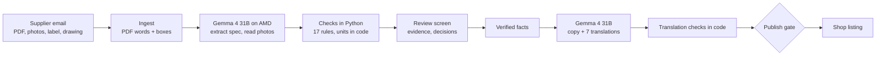

# ShelfReady

**The trust layer for product data.** Supplier spec sheets and photos often contradict each other. ShelfReady
finds those contradictions with evidence, asks a person only what the evidence cannot settle, and writes
multilingual shop listings from verified facts only.

Built for the AMD Developer Hackathon: ACT III, **Reinvent Commerce** track. Model: **Gemma 4 31B** on AMD.

- **Live demo:** https://shelfready-liard.vercel.app (sample shop "Casa Nord", 25 supplier submissions, 250 real listings)
- **Code:** MIT. Data sources and licences: [DATA_LICENSES.md](DATA_LICENSES.md)
- **Demo video narration:** voice generated with [ElevenLabs](https://elevenlabs.io)

## The problem

- **Returns:** 60.4% of German online shoppers have returned items because the description or photos did not match
  the product (KPMG/EHI 2025). A wrong width, colour or care instruction on a product page becomes a return.
- **EU law:** since 13 Dec 2024 the General Product Safety Regulation (GPSR, Art. 19) requires every online offer to
  show the manufacturer, an EU responsible person for non-EU makers, product photos and safety warnings in the
  shopper's language. The European Accessibility Act (from 28 Jun 2025) makes product photos need text alternatives.
- **Languages:** 76% of shoppers prefer buying in their own language (CSA 2020). Small shops copy supplier data by hand
  into 5–8 languages.

## What it does

1. **Reads the supplier's email**: spec sheet PDF (words with positions), product photos, care label, dimension drawing.
2. **Extracts the spec** and **looks at every photo, label and drawing** with Gemma 4 31B (vision), with boxes on
   what it sees.
3. **Checks the supplier's data against its own evidence** in plain Python: 17 rules (D1–D17), for example width
   in the spec vs the drawing, colour name vs the photos, washing instructions vs the sewn-in care label, missing
   EU responsible person, unclear health claims, invalid barcodes. Units and numbers are handled in code, not by
   the model.
4. **Asks a person only what the evidence cannot settle.** A size that the supplier's own dimension drawing shows
   is settled automatically and shown as one line ("Checked: width 226 cm (drawing)") that a person can change.
   Photo readings such as colour or material always go to a person, with both sources side by side. Open facts are
   **held back** from the copy instead of guessed.
5. **Writes the listing from verified facts only** (title, bullets, description, safety warnings, alt text for every
   photo) in English, then translates it into Spanish, Italian, German, French, Portuguese, Polish and Ukrainian.
   **Every translation is checked in code**: numbers, units, protected names and a glossary.
6. **Publish gate:** nothing is published while a blocking finding is open, a question to the supplier is pending,
   or a legal checklist item (GPSR Art. 19, textile fibres, claims, EAN, alt text) fails. Every decision is logged.
7. **Catalogue health:** the same checks audit a shop's **existing** listings against their photos.

## Measured results

| What | Result | How it was measured |
|---|---|---|
| Planted defects found | **57 of 59 (recall 0.966)**, precision **0.983** | 25 synthetic supplier submissions with 59 planted defects and a ground truth (`data/defects.yaml`); real Gemma 4 31B output; `cd backend && uv run python -m app.eval.metrics` |
| False alarms on clean products | **0 of 6** | same run |
| Real listings audited | **250 listings, 900 photos**: health score **94.9/100**, **5** listings with blocking issues | Amazon Berkeley Objects listings (CC BY 4.0) checked against their own photos (`data/results/audit.json`) |
| Audit photo findings judged right by a person | **29 of 30 (97%)** | human spot check, method and details in [data/eval/README.md](data/eval/README.md) |

Real catches in the audit include a wristwatch listed under chairs, listings whose only photo is a logo or
"Image coming soon", a three-seat power sofa filed as a chair, and a "Marrone" (brown) sofa whose photos are grey.

## How it uses AMD

- **Every model call runs on AMD:** Gemma-4-31B-IT on **AMD Token Factory** (AMD-hosted, OpenAI-compatible) does
  spec extraction, photo/label/drawing reading, listing copy and translation. All answers are recorded in
  `data/replay/` (1,480+ responses), so the demo replays real model output without a key.
- **Served ourselves on an AMD Instinct MI300X** (AMD Developer Cloud, vLLM ROCm image) during a test session:
  Gemma 4 31B read 10/10 spec fields and drew accurate boxes, tool calls worked, and throughput reached
  **144 photos/min at 64 concurrent requests (≈ €0.21 per 1,000 photos)**. vLLM 0.27.1 needs `transformers==5.13.1`
  for Gemma 4; the launch script is [infra/start_vllm.sh](infra/start_vllm.sh). Switching is one setting
  (`LLM_BASE_URL`, `LLM_JSON_MODE=json_schema`).
- We chose the largest Gemma 4 model on purpose: photo-vs-spec checks need the vision quality.

## Why Gemma 4 31B

Gemma 4 31B is the only model in ShelfReady, and it does every AI step:

- **Vision:** reads spec-sheet pages, product photos, care labels and dimension drawings, and draws boxes on what it
  sees (Gemma's 0–1000 box format), shown as evidence on the review screen.
- **Structured extraction:** the supplier's spec as JSON, validated with Pydantic.
- **Writing and translation:** listing copy, safety warnings and alt text, translated into 7 languages and checked in code.
- **Agent:** the Evolus shop assistant runs on it, with tool calling.

All of it on AMD: **1,593 live calls to Gemma-4-31B-IT** (1.75M tokens read, 445k written), recorded in `data/replay/`.
We tested Gemma 4 31B and 26B-A4B on an AMD Instinct MI300X and chose the 31B.

## Evolus business agents (on the same Gemma 4 31B on AMD)

ShelfReady drives an [Evolus](https://evolus.ai) workspace through its APIs (`backend/app/clients/evolus.py`):

- **Email AI Tool:** the questions a reviewer sends to the supplier become a ready-to-send email
  (button "Write the email to the supplier"; `POST /api/products/{id}/supplier-email`).
- **Knowledge library:** when a product is published, its verified facts (with the person's decisions applied) are
  uploaded to the library "Casa Nord verified products" (`/api/v1/memories/{id}/documents`, language `en`).
- **Agent:** "Casa Nord shop assistant" answers shoppers on the shop page (`/shop/{id}`, e.g. `/shop/SYN-10`) from that
  library only, in the page's language, through Evolus's OpenAI-compatible agent chat (`POST /api/shop/{id}/ask`).

The workspace's model is **Gemma-4-31B-IT on AMD Token Factory**, connected in Evolus "Your models" (it passes Evolus's
connection test: answers, tool calling and streaming). The event FAQ states the event runs on Token Factory ("Just the
api from the tokenfactory"). Settings: `EVOLUS_API_KEY`, `EVOLUS_APP_ID`, `EVOLUS_AGENT_ID`, `EVOLUS_LIBRARY_PRODUCTS_ID`.

## Architecture



- **Backend:** Python 3.12, FastAPI, Pydantic v2, SQLite (decisions, publishing, event log), `uv`.
  Code in `backend/app/`: `pipeline/` (ingest, spec, photos, normalise, checks, audit, listing, translate_qa),
  `clients/llm.py` (OpenAI-compatible client with live / replay / cached / mock modes and rate limiting),
  `api.py`, `store.py`.
- **Frontend:** Next.js 16 + React 19 in `frontend/`; it calls the API through `/backend/*` on the same origin.
- **Data:** `data/synthetic/` (25 fictional supplier submissions for the shop "Casa Nord"), `data/abo/` (the real
  listings used by the audit), `data/results/` (pipeline output the app serves), `data/replay/` (recorded model answers).

## Run it

### With Docker (no key, no GPU)

```bash
git clone https://github.com/KostiantynBk/shelfready && cd shelfready
docker compose up --build
```

Open http://localhost:3000. The API is on http://localhost:8080 (`/docs` lists every endpoint). It runs in
**replay mode**: model answers come from `data/replay/`.

### Without Docker

```bash
# API (Python 3.12 + uv)
cd backend && uv sync && uv run uvicorn app.main:app --port 8000
# Web app, in a second terminal (Node 20+)
cd frontend && npm install && npm run dev
```

Open http://localhost:3000.

### With the live model (optional)

Copy `.env.example` to `.env` and set `LLM_API_KEY` (AMD Token Factory) and `LLM_MODE=cached` (recorded answers when
available, otherwise the live model). Decisions that change the verified facts then let you write new copy with the
model ("Write copy" on the review screen). Never commit `.env`.

### Public demo hosting

The live demo is two Vercel projects from this repo: the website (`frontend/`) and the API (`index.py` at the repo
root, which serves the FastAPI app with the `data/` folder; see `vercel.json`). The API runs in replay mode and keeps
decisions in the function's `/tmp`, so demo decisions can reset when Vercel recycles the instance.
`infra/deploy.sh` runs the same API on any Ubuntu server with Docker and Caddy instead.

### Tests

```bash
cd backend && uv run pytest && uv run ruff check .
cd frontend && npx tsc --noEmit && npm run lint
```

## Try the demo

1. **Supplier inbox** → open **LISBOA** (armchair, 9 planted defects): see the spec sheet and photos side by side with
   the contradiction highlighted, decide each finding, and publish.
2. Findings settled from evidence collapse into one "Checked from evidence" line, e.g. the width on **LUCCA** (sofa).
3. **Catalogue health** shows the audit of 250 real listings; **Insights** shows the measured results above.
4. **Online store** (`/shop/SYN-10`, ÉVORA): ask the Evolus shop assistant about size, materials or care.
5. `POST /api/demo/reset` clears all decisions.

## Limitations

- The supplier submissions are synthetic (fictional shop, planted defects) so that results can be measured; the
  audit uses real listings and real photos.
- The model reports one main colour per photo, so a missing second colour of a two-colour product is not caught.
- Translations are machine-checked (numbers, units, names, glossary); only Ukrainian was read by a person.
- Evolus writes the supplier email; sending it from a connected mailbox is not built yet.

## Licence

MIT for the code. Data licences: [DATA_LICENSES.md](DATA_LICENSES.md).
